# Phase 1: Highly available web app

## Goal

Security officers report incidents through a web app that keeps working when a server, or a whole Availability Zone, fails. Servers must not be reachable from the internet, and no passwords may be stored in code or on disk in the repo.

## Architecture

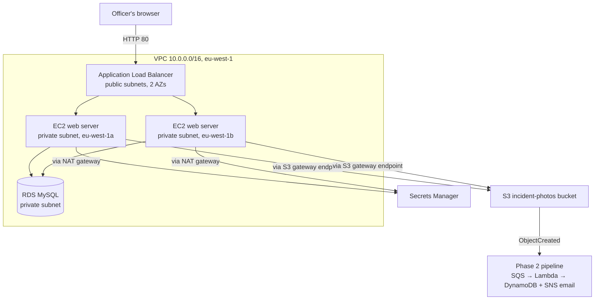

Why each piece is there:

| Service | Role | Why this choice |
|---|---|---|
| VPC with public and private subnets in 2 AZs | Network isolation | Only the load balancer and NAT gateway are public; servers and database are private |
| Application Load Balancer | Single entry point, spreads traffic across AZs | Stops sending traffic to a server as soon as its health check fails |
| EC2 Auto Scaling group (2–4 servers) | Runs the app | Replaces failed servers automatically and keeps one in each AZ |
| Launch template + user data | Server blueprint | Every new server installs and starts the app the same way, with no manual steps |
| RDS MySQL | Stores incident reports | Managed backups and patching; private subnets only |
| Secrets Manager | Holds the database password | RDS manages and rotates it; the app reads it at startup |
| NAT gateway (1 AZ) | Outbound internet for private servers | Needed to install packages and reach Secrets Manager |
| S3 gateway endpoint | Private route to S3 | Photo uploads don't go through the NAT gateway, and the endpoint itself is free |
| Session Manager | Shell access to servers | No SSH port, no key pairs, every session logged |

## What I built

1. **VPC** `secureshift-vpc` (10.0.0.0/16) with:
   - Public subnets 10.0.1.0/24 (eu-west-1a) and 10.0.2.0/24 (eu-west-1b)
   - Private subnets 10.0.11.0/24 (eu-west-1a) and 10.0.12.0/24 (eu-west-1b)
   - Internet gateway, one zonal NAT gateway in eu-west-1a, an S3 gateway endpoint, and separate public and private route tables
2. **Security groups**, each one only allowing traffic from the layer in front of it:

   | Security group | Inbound | From |
   |---|---|---|
   | `secureshift-alb-sg` | HTTP 80 | Anywhere (0.0.0.0/0) |
   | `secureshift-web-sg` | HTTP 80 | `secureshift-alb-sg` only |
   | `secureshift-db-sg` | MySQL 3306 | `secureshift-web-sg` only |

   No SSH rule anywhere. Server access is through Session Manager.
3. **RDS MySQL** `secureshift-db`: db.t4g.micro, gp3 20 GiB, in a DB subnet group with the private subnets only, public access off, master password managed in Secrets Manager.
4. **IAM role** `secureshift-web-role` for the servers:
   - `AmazonSSMManagedInstanceCore` for Session Manager
   - An inline policy allowing only `s3:PutObject` on `secureshift-incident-photos/incidents/*` and `secretsmanager:GetSecretValue` on the RDS-managed secret
5. **The app**: a small Flask app ([`app/app.py`](../app/app.py)) run by gunicorn as a systemd service.
   - The home page shows which server and AZ answered the request, a report form, and the last 10 incidents.
   - A report is validated (required fields, JPEG/PNG only, max 5 MB), the photo is uploaded to S3 under `incidents/`, and the report is saved in RDS.
   - The S3 upload triggers the [Phase 2 pipeline](02-serverless.md), so the supervisor gets an email for every report.
   - `/health` returns `ok` for the load balancer.
6. **Launch template** `secureshift-web-lt`: t3.micro, Amazon Linux, `secureshift-web-sg`, `secureshift-web-role`, no key pair. The user data ([`scripts/user-data.sh`](../scripts/user-data.sh)) installs Python packages, writes the app, and starts the service. The real DB endpoint and secret ARN are replaced with `REPLACE_ME` placeholders in the repo.
7. **Target group** `secureshift-web-tg` (HTTP 80, health check path `/health`).
8. **Application Load Balancer** `secureshift-alb`: internet-facing, both public subnets, listener HTTP 80 → `secureshift-web-tg`.
9. **Auto Scaling group** `secureshift-web-asg`: both private subnets, desired/min/max 2/2/4, ELB health checks with a 300-second grace period, and a target tracking policy at 50% average CPU.

## Testing

| Test | Expected | Result |
|---|---|---|
| Open the load balancer address and refresh | Requests answered by servers in both AZs | ✅ Alternated between eu-west-1a and eu-west-1b |
| Submit a report with a photo | Saved in RDS, photo in S3, alert email | ✅ All three; the email arrived within a minute |
| Instance refresh after fixing the launch template | Servers replaced one at a time | ✅ Both servers replaced, target group back to 2 healthy |
| Terminate a running server | ASG detects it and launches a replacement | ✅ Detected and replacement launched at the same second (04:17:37); 2 healthy targets again about 4 minutes later |

## Screenshots

**VPC resource map: subnets, route tables, NAT gateway, S3 endpoint**

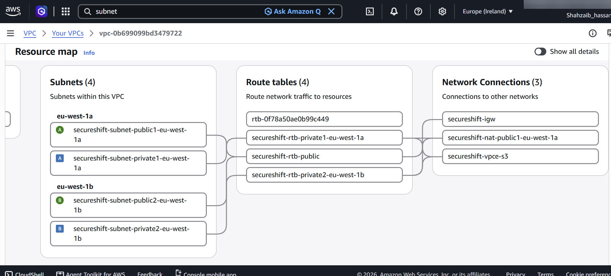

**Security groups**

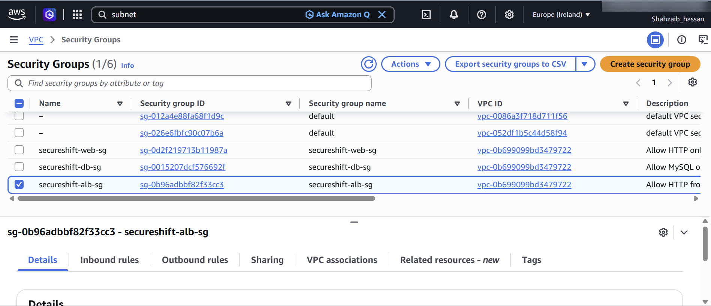

**Web servers only accept traffic from the load balancer**

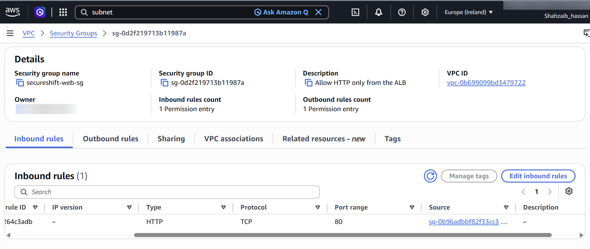

**RDS database (Single-AZ)**

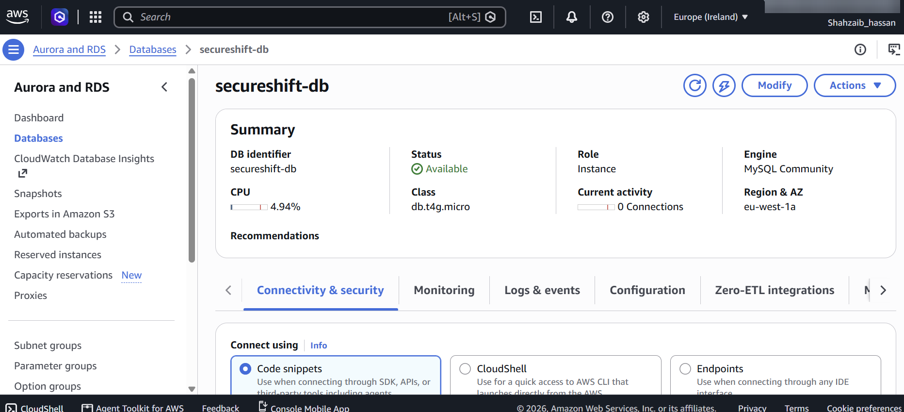

**Multi-AZ option blocked on the free plan**

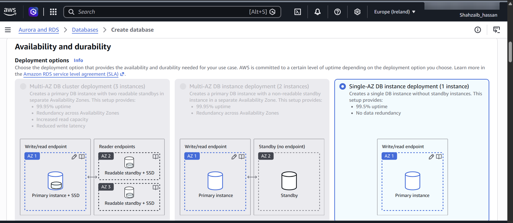

**Web server role permissions**

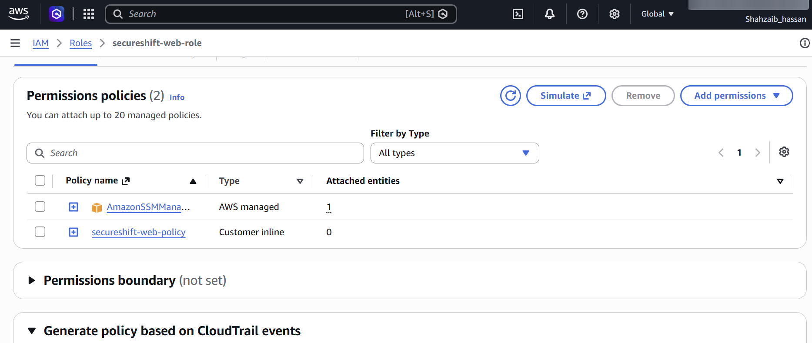

**Launch template**

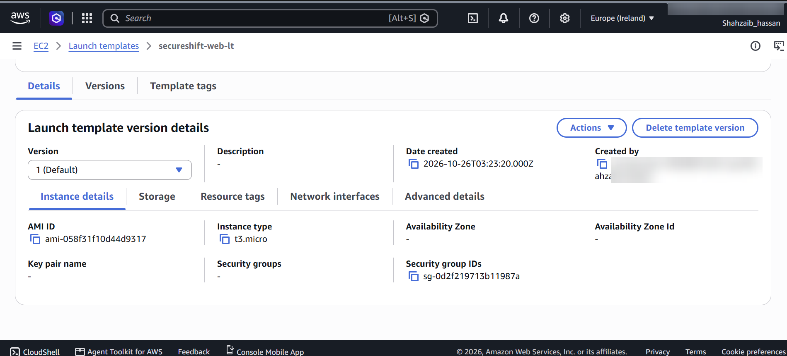

**Load balancer listener forwarding to the target group**

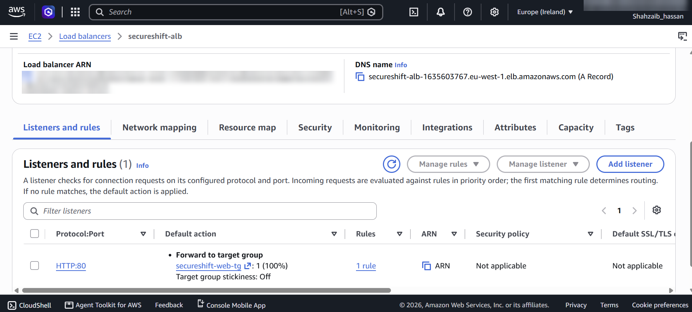

**Two healthy targets, one per AZ**

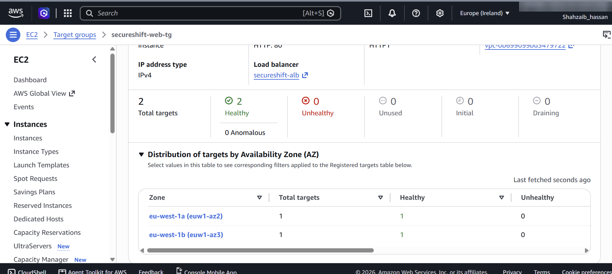

**Auto Scaling group instances**

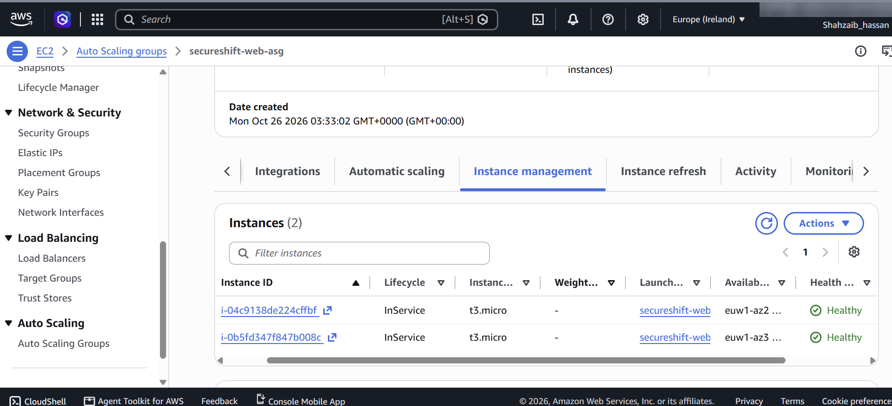

**App served from eu-west-1b...**

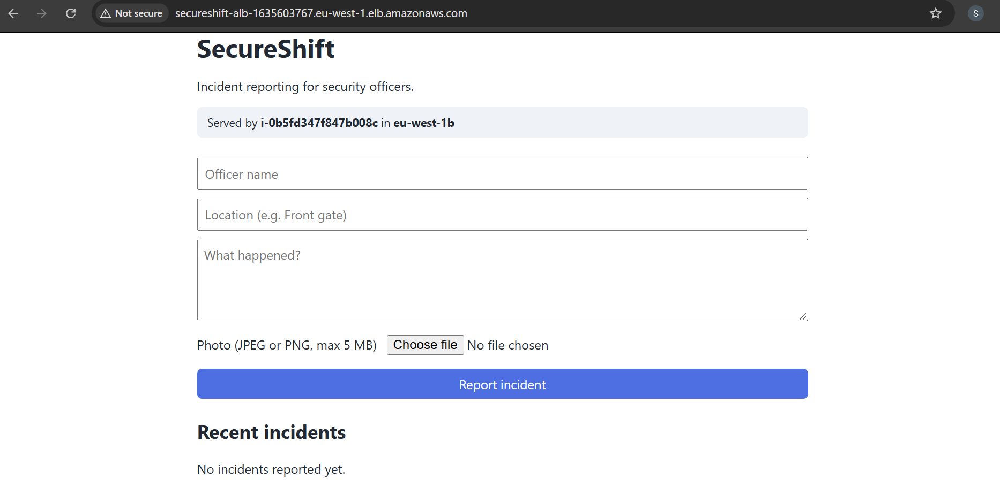

**...and from eu-west-1a on refresh**

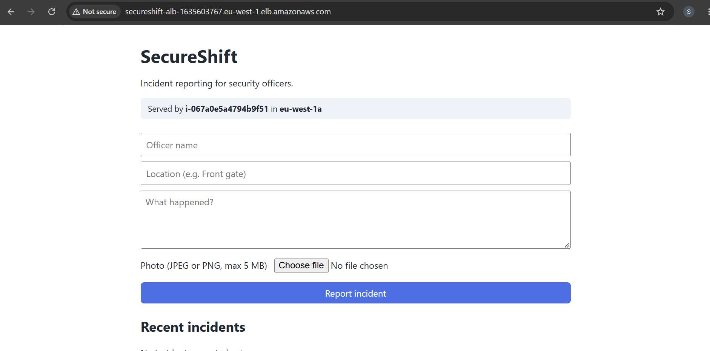

**Incident reported and saved in RDS**

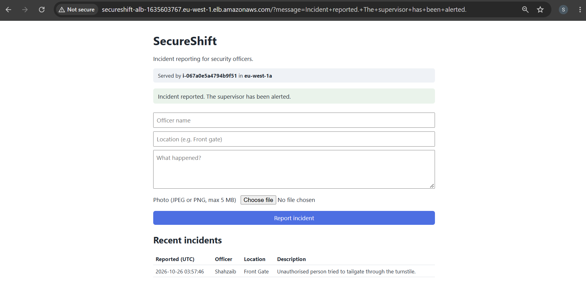

**Supervisor alert from the Phase 2 pipeline**

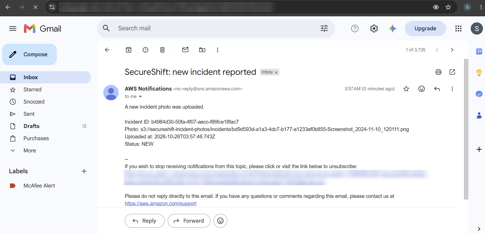

**Photo stored in S3**

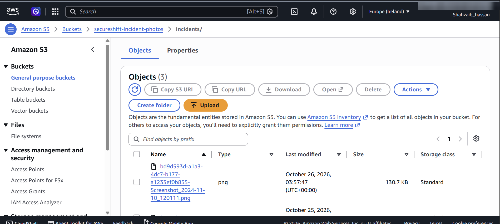

**Instance refresh replacing servers one at a time**

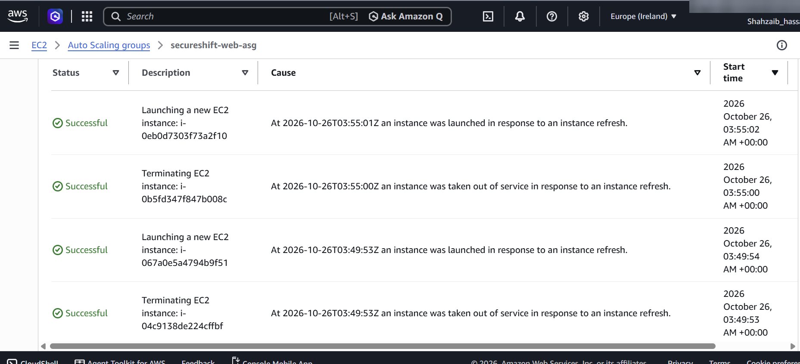

**Back to two healthy targets after the refresh**

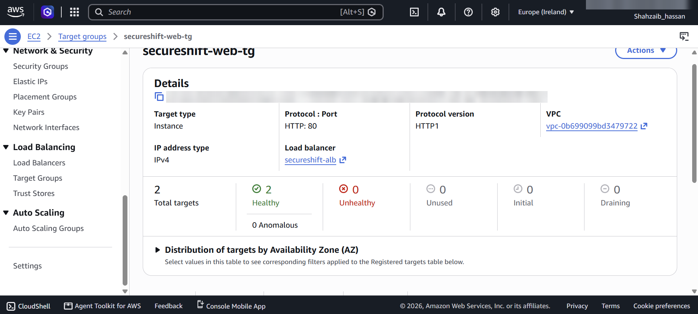

**HA test: the ASG replaces a terminated server by itself**

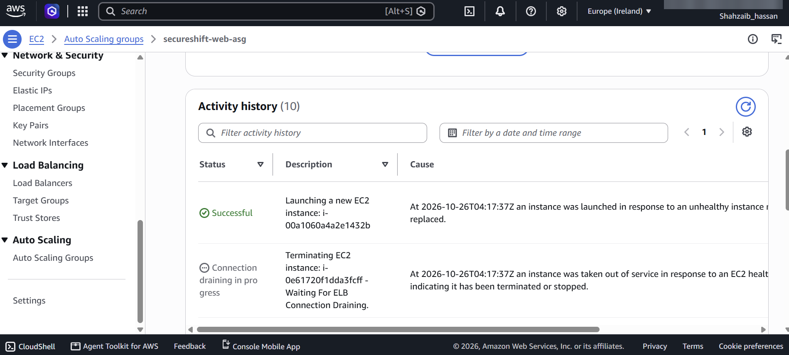

**HA test: recovered to two healthy targets**

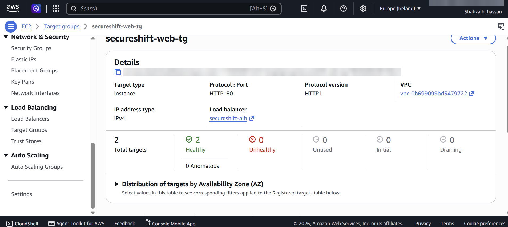

## Problems I hit and how I fixed them

- **Servers healthy, but the page said "Database is unavailable".** The health check passed because `/health` doesn't touch the database. I connected to a server with Session Manager and read the app logs with `journalctl -u secureshift`, which showed: `'cryptography' package is required for sha256_password or caching_sha2_password auth methods`. MySQL 8 uses `caching_sha2_password` by default, and PyMySQL needs the `cryptography` package for it. I added the package to the user data, created launch template version 2, pointed the ASG at the latest version, and ran an instance refresh. Fixing a server by hand would not have lasted, because the next server the ASG launched would have had the same problem.
- **Keeping `/health` shallow on purpose.** A health check that also tested the database would mark every server unhealthy during a database outage. With ELB health checks on, the ASG would then keep terminating and replacing servers that were actually fine.
- **Multi-AZ RDS was blocked.** The free plan doesn't allow Multi-AZ deployments (greyed out even with the Dev/Test template), so the database is Single-AZ. The web tier survives an AZ failure; the database doesn't. In production this would be Multi-AZ.
- **The NAT gateway screen had changed.** The console now offers Regional and Zonal NAT gateways. A Regional NAT gateway is billed for each AZ it's active in, so I chose one Zonal NAT gateway in eu-west-1a to keep cost down.

## What I'd change in production

- **RDS Multi-AZ**, deletion protection on, and longer backup retention.
- **One NAT gateway per AZ.** With one NAT in eu-west-1a, an outage in that AZ would stop the eu-west-1b servers reaching the internet and Secrets Manager.
- **Interface VPC endpoint for Secrets Manager**, so reading the database password doesn't depend on the NAT gateway.
- **HTTPS** with a domain, an ACM certificate and an HTTP→HTTPS redirect; the app is HTTP only here because there's no domain.
- **AWS WAF** on the load balancer.
- **A pre-built AMI** (EC2 Image Builder) instead of installing packages at boot, to cut the roughly 4-minute recovery time and avoid depending on package downloads during a failure.
- **CloudWatch alarms** on unhealthy targets and load balancer 5xx errors.
- **Infrastructure as code** (CloudFormation or Terraform) so the whole stack can be rebuilt in minutes.

## Cost

The ongoing costs in this phase are the NAT gateway, the load balancer, the two EC2 servers and RDS, so I built and tested everything in one session and then tore it down:

- Auto Scaling group set to 0/0/0
- Load balancer deleted
- NAT gateway deleted and its Elastic IP released
- RDS stopped (it restarts by itself after 7 days)

The VPC, subnets, security groups, launch template and target group are free to keep. Exact figures are in the [cost report](cost-report.md).
