# Phase 2: Serverless, event-driven pipeline

## Goal

When a security officer uploads an incident photo, the system records the incident and alerts the supervisor automatically, with no servers to manage. If processing fails, the incident must not be lost.

## Architecture

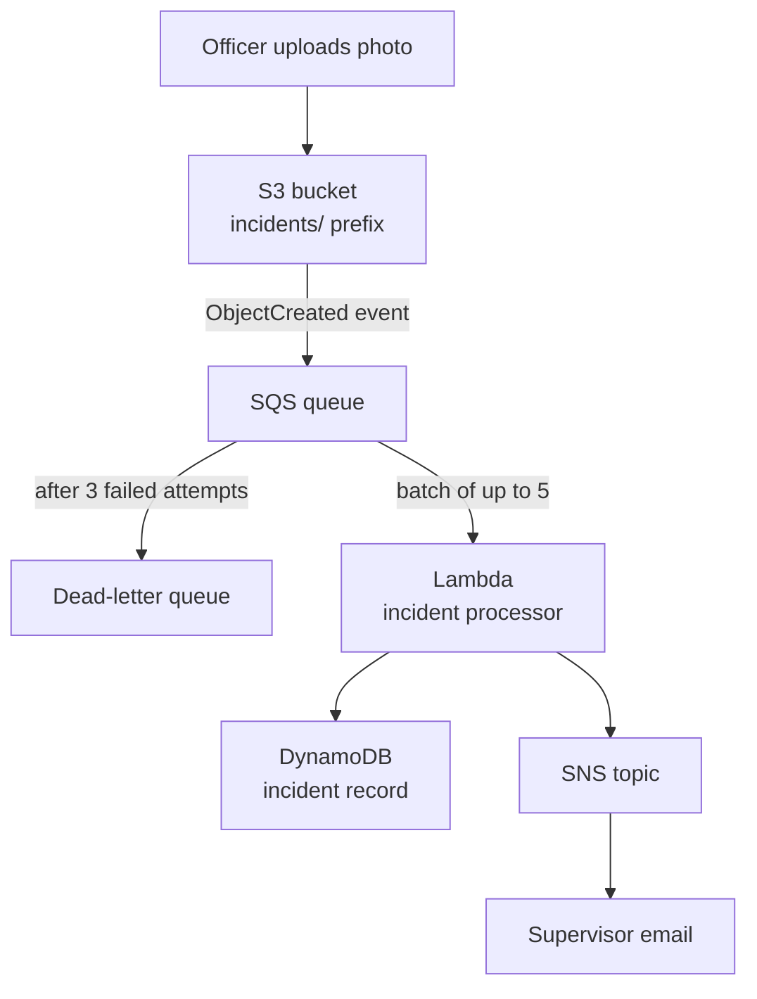

Why each piece is there:

| Service | Role | Why this choice |
|---|---|---|
| S3 | Stores incident photos | Private bucket, Block Public Access on, SSE-S3 encryption |
| SQS | Buffers upload events | Absorbs bursts, retries failures, decouples S3 from Lambda |
| SQS dead-letter queue | Holds messages that failed 3 times | Failed incidents are kept for 14 days instead of disappearing |
| Lambda | Processes each upload | Runs only when there is work; no servers |
| DynamoDB | Stores the incident record | On-demand capacity, so it costs nothing while idle |
| SNS | Emails the supervisor | Simple fan-out; more subscribers can be added later |

## What I built

1. **SNS topic** `secureshift-incident-alerts` with a confirmed email subscription.
2. **DynamoDB table** `secureshift-incidents`, partition key `incidentId` (String), on-demand capacity.
3. **SQS queues**
   - `secureshift-incidents-dlq`: retention 14 days.
   - `secureshift-incidents-queue`: visibility timeout 3 minutes (6× the Lambda timeout), dead-letter queue after 3 receives.
4. **S3 bucket** `secureshift-incident-photos`, private, with an event notification for all object-create events under `incidents/` sent to the queue.
5. **Queue access policy** that only lets this bucket, in this account, send messages:

```json
{
  "Sid": "AllowS3UploadEvents",
  "Effect": "Allow",
  "Principal": { "Service": "s3.amazonaws.com" },
  "Action": "SQS:SendMessage",
  "Resource": "arn:aws:sqs:eu-west-1:ACCOUNT_ID:secureshift-incidents-queue",
  "Condition": {
    "ArnLike": { "aws:SourceArn": "arn:aws:s3:::secureshift-incident-photos" },
    "StringEquals": { "aws:SourceAccount": "ACCOUNT_ID" }
  }
}
```

6. **IAM role** `secureshift-incident-processor-role` with least privilege:
   - `AWSLambdaBasicExecutionRole` (CloudWatch logs only)
   - An inline policy allowing only `sqs:ReceiveMessage`, `sqs:DeleteMessage` and `sqs:GetQueueAttributes` on the queue, `dynamodb:PutItem` on the table, and `sns:Publish` on the topic.
7. **Lambda function** `secureshift-incident-processor` (Python, arm64, 30-second timeout), triggered by the queue with batch size 5 and **Report batch item failures** turned on. Code: [`lambda/incident-processor/lambda_function.py`](../lambda/incident-processor/lambda_function.py)
   - Skips the `s3:TestEvent` message and folder markers.
   - Writes the incident to DynamoDB, then publishes the alert.
   - Reports failed messages individually, so one bad message doesn't make the whole batch retry.
   - Fails on purpose for any file name containing `force-fail`, to test the dead-letter queue.

## Testing

| Test | Expected | Result |
|---|---|---|
| Upload `incidents/WALLPAPER 1.jpg` | Record in DynamoDB + email alert | ✅ Both within about a minute; the space in the file name was decoded correctly |
| S3 test event and folder marker | Skipped, no record, no email | ✅ Logged as skipped |
| Upload `incidents/force-fail-test.jpg` | No record, no email, message in DLQ after 3 attempts | ✅ Message in DLQ after about 10 minutes |

## Screenshots

**SNS email subscription confirmed**

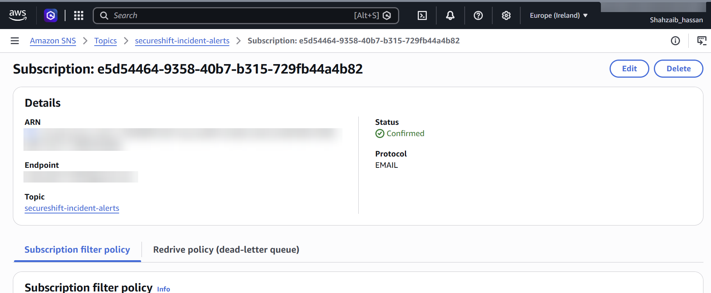

**DynamoDB table (on-demand)**

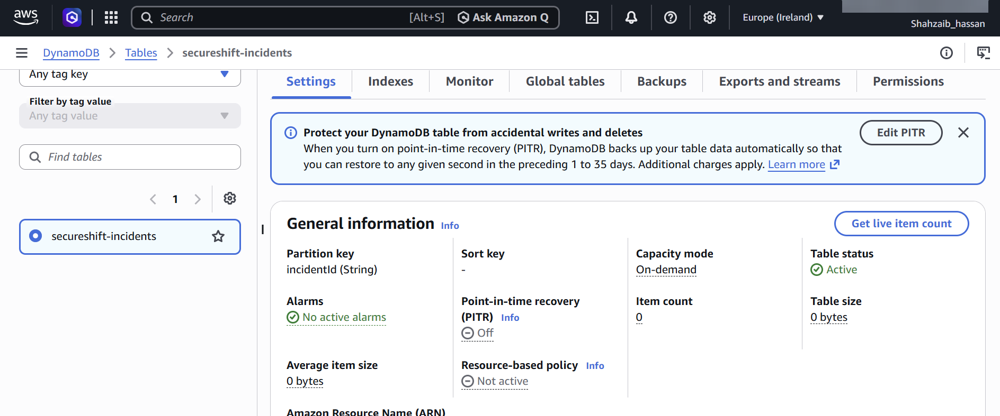

**SQS queue and dead-letter queue**

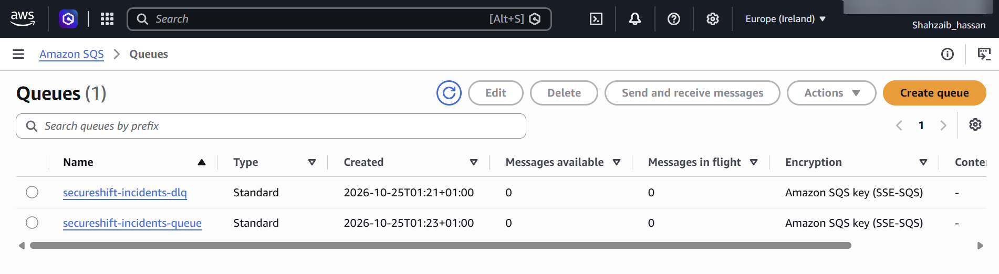

**S3 bucket with Block Public Access on**

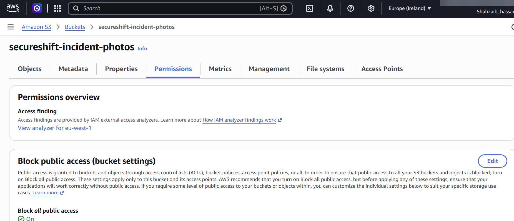

**S3 event notification to SQS**

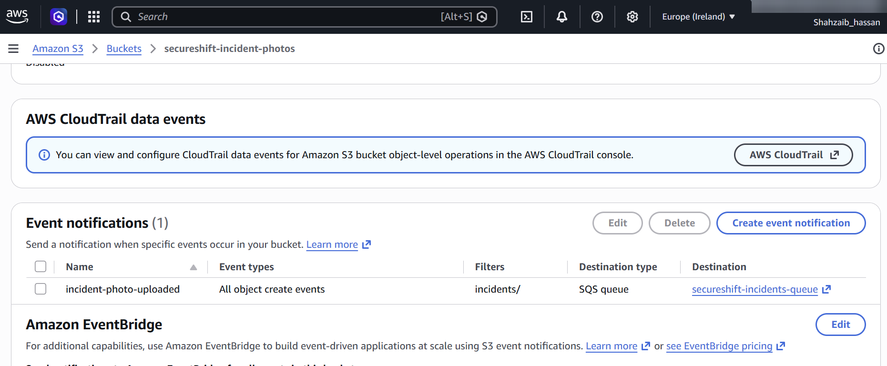

**Upload events arriving in the queue**

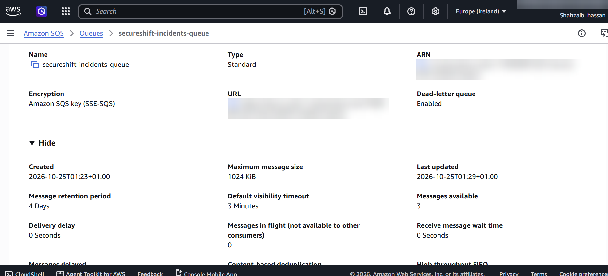

**Lambda role with least-privilege policies**

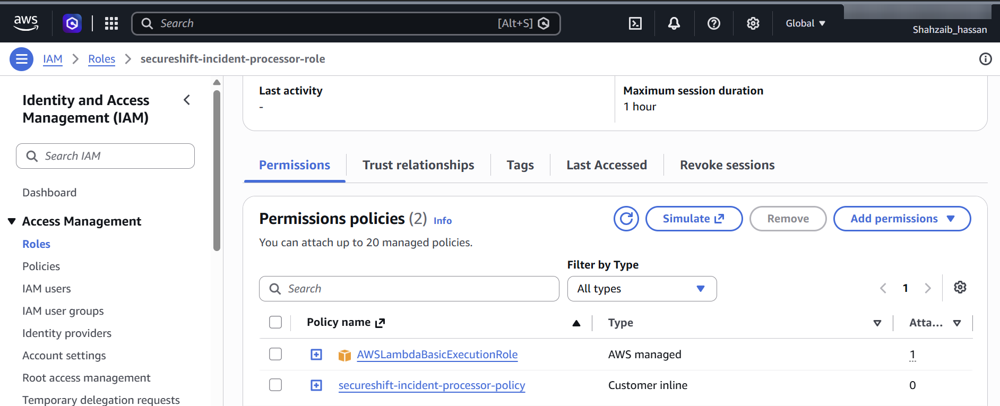

**Lambda function with the SQS trigger enabled**

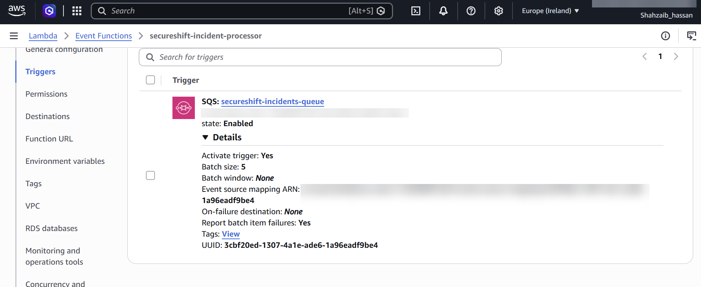

**Supervisor alert email**

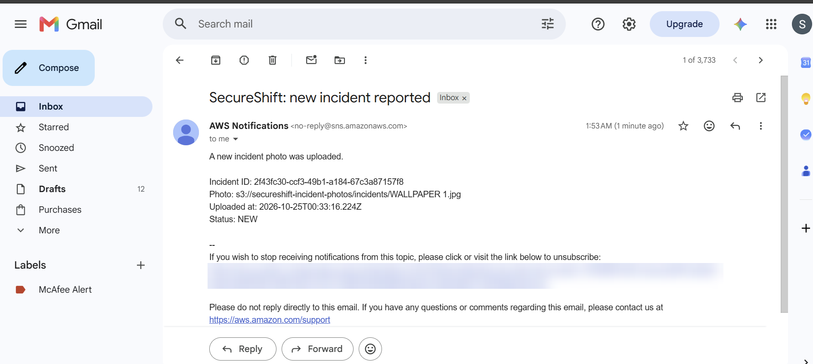

**Incident record in DynamoDB**

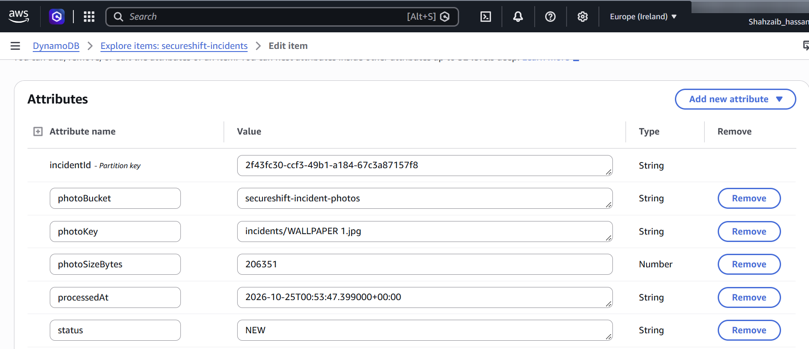

**Lambda logs in CloudWatch**

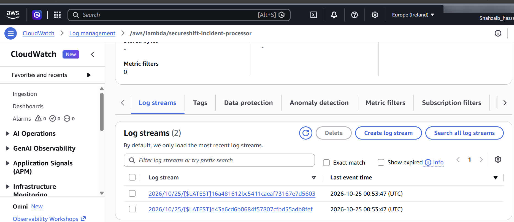

**Failed message in the dead-letter queue**

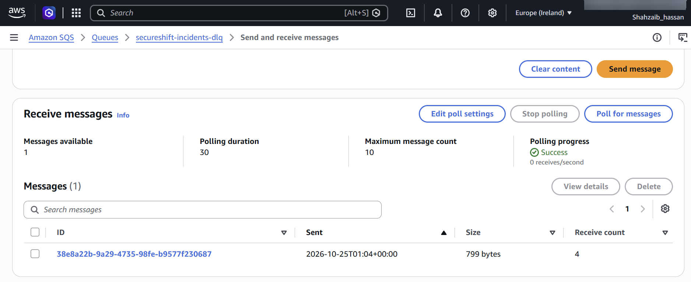

## Problems I hit and how I fixed them

- **Wrong managed policy on the Lambda role.** I attached `AWSLambdaExecute` instead of `AWSLambdaBasicExecutionRole`. The names look alike, but `AWSLambdaExecute` also allows reading and writing objects in every S3 bucket in the account. The function doesn't need S3 access at all, so I replaced it with the logs-only policy.
- **Three messages in the queue instead of one.** S3 sends an `s3:TestEvent` when the notification is created, and creating the `incidents` folder in the console uploads an empty `incidents/` object, which also fires the event. I made the function skip both.
- **The DLQ message showed a receive count of 4, not 3.** Polling the DLQ in the console to look at the message counts as a receive too.

## What I'd change in production

- **CloudWatch alarm on the DLQ** so someone is alerted as soon as an incident fails, instead of checking the queue manually.
- **DynamoDB point-in-time recovery** (left off here to avoid extra cost).
- **Customer managed KMS keys** for S3, SQS and SNS, for control over and auditing of the encryption keys.
- **Presigned upload URLs** so the web app uploads directly to S3 without ever holding AWS credentials.
- **S3 lifecycle rule** to move old incident photos to a cheaper storage class.
- **Infrastructure as code** (CloudFormation or Terraform) instead of console clicks, so the whole pipeline can be rebuilt in minutes.

## Cost

About $0. Lambda, SQS, SNS and DynamoDB at this volume stay within AWS's always-free allowances, and S3 storage for a few test photos costs fractions of a cent. Nothing here costs money while idle, so these resources stay up for Phase 1.
